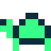

<!--
  README SKELETON
  Comments like this one are notes for you: they don't render on GitHub.
  Delete each one once you fill in its section.
-->

<p align="center">
  
</p>

<h1 align="center">&gt;CodeTypeShell_</h1>

<p align="center">
  <!-- One line that explains the project. For example: -->
  A typing test made by and for coders.
</p>

<p align="center">
  <a href="#">demo</a> ·
  <a href="#features">features</a> ·
  <a href="#running-locally">run locally</a> ·
  <a href="#roadmap">roadmap</a>
</p>

---

<!-- Screenshot or GIF of a game in progress. Store it in, e.g., multimedia/readme/ -->


## What is it

- Train your typing speed on real scripts, written on Java, C++, Python...
- Minimalistic and retro, type your code into the terminal and aim for the highest score.
- Inmidiate analysis of your typing, check your CPMs and a detail graph of your performance.

<!--
  2-3 sentences:
  - The problem: regular typing tests don't train symbols, braces or indentation.
  - The idea: type real snippets of Java, Python, C++…
  - The inspiration: MonkeyType's minimalism + an 80s terminal/arcade look.
-->

## Features

<!-- List what already works; leave the rest for the roadmap -->

- **Real code** in multiple languages: Java, Python and C++.
- **Modes:** by time or scripts, or just blow some steam off on freestyle mode.
- **Arcade scoring** with a multiplier that drops on every mistake.
- **Per-game chart** when the round ends.
- Optional **CRT effect** and retro sound effects.
- **Straight to the point:** load the page and start typing without any interruptions

## How to play

-Choose a **languge** and a **GameMode**
-Start typing and score points as you complete lines of code.
-**Tab + Intro** for a quick reset of the test
-Check your scores and stats after you are done 

## Running locally

No dependencies and no build step. You do need a **local server**, though, because the game loads snippets with `fetch()`, which doesn't work over `file://`.

```bash
git clone <repo-url>
cd TypeCodeTurt
python -m http.server 8000
```

Then open `http://localhost:8000`.
The VS Code **Live Server** extension works too.

## Adding a language or more snippets

Snippets live in `js/<language>.json`:

```json
{
  "lenguaje": "java",
  "indentacion": "    ",
  "scripts": [
    {
      "lineas": [
        { "nivel": 0, "piezas": ["public", "class", "Main", "{"] },
        { "nivel": 1, "piezas": ["}"] }
      ]
    }
  ]
}
```

- `nivel`: how many times `indentacion` is repeated at the start of the line.
- `piezas`: the line's tokens, joined with a single space.

To add a new language, create `js/<name>.json` and add `<li><name></li>` to the `#lista` list in `index.html`.

<!-- If you accept snippet contributions, say so here -->

## Tech stack

<!-- Explain why it's vanilla: it's a deliberate choice, not a limitation -->

- Semantic HTML5
- CSS3: grid and flexbox, with custom properties for the palette
- Vanilla JavaScript (ES2020+, classes), no frameworks and no bundler
- Fonts from Google Fonts: Press Start 2P, VT323…

## Project structure

```
TypeCodeTurt/
├── index.html            Main page
├── js/
│   ├── effects.js        Sound effects and screen shake
│   ├── score.js          ScoreTracker: score, mode and duration
│   ├── gameRecorder.js   GameRecord: keystroke log
│   ├── chart.js          StatsChart: SVG chart of the game
│   ├── typing.js         TypingGame: game core (input, rendering, caret, timer)
│   ├── gameMenu.js       GameMenu: hover/focus states of the mode buttons
│   ├── java.json         ┐
│   ├── python.json       ├ Code snippets
│   └── cpp.json          ┘
├── style/
│   ├── style.css         Look: palette, typography and components
│   ├── format.css        Layout (grid + flexbox)
│   └── crt.css           CRT monitor effect (.crt class on <body>)
└── multimedia/           SVG icons (with *Selected variants), mascot and .wav sounds
```

Scripts are loaded with `defer`, without ES modules, in this order:
`effects` → `score` → `gameRecorder` → `chart` → `typing` → `gameMenu`.

## Roadmap

- [x] `time` mode (15 / 30 / 60 s)
- [ ] `script` and `freestyle` modes
- [ ] Config, Stats and About pages
- [ ] More snippets per language
- [ ] Basic SEO and deployment
- [ ] Leaderboard (needs a backend)

<!-- The detailed list lives in TODO.md -->
## License

All rights reserved

## Author

Campos Duarte, Marcos Galileo
